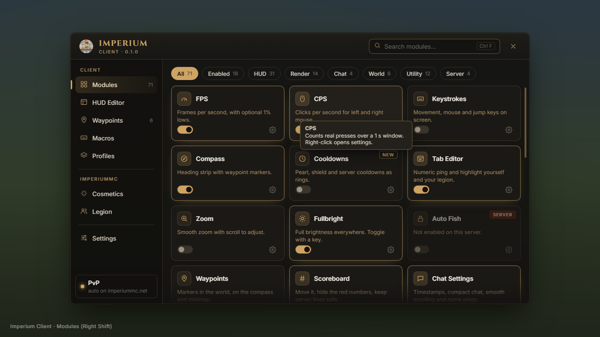
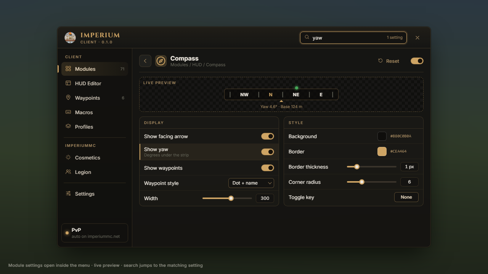
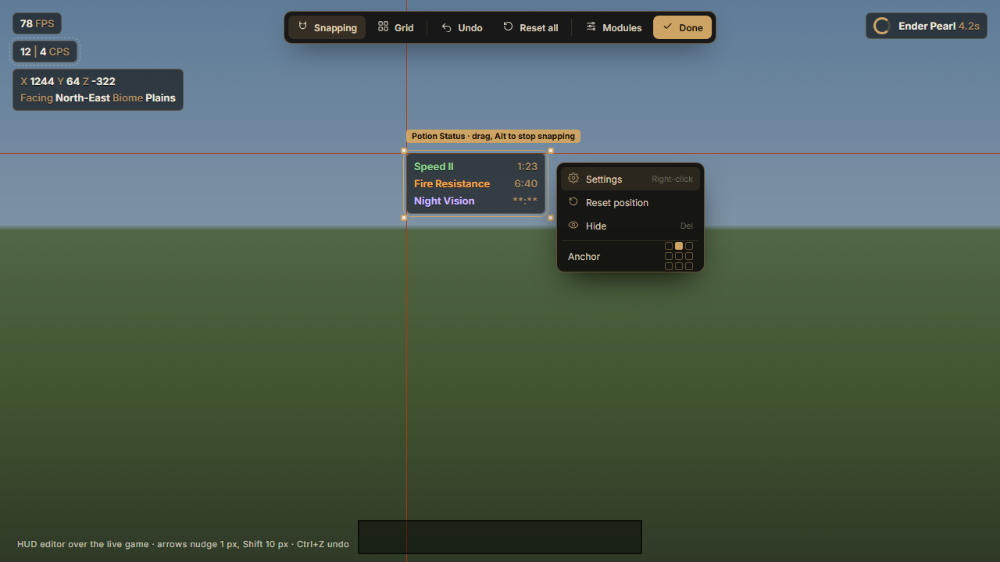
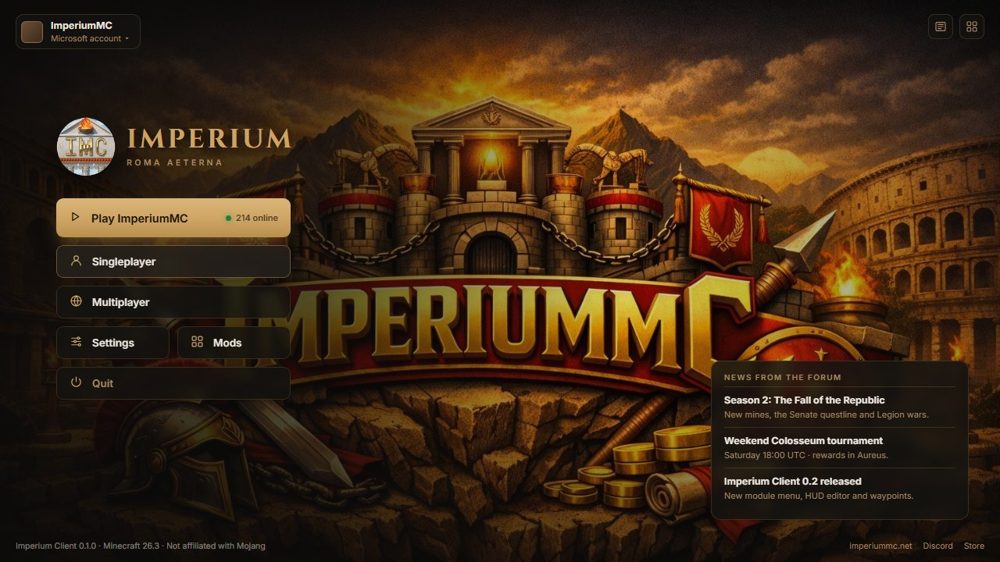
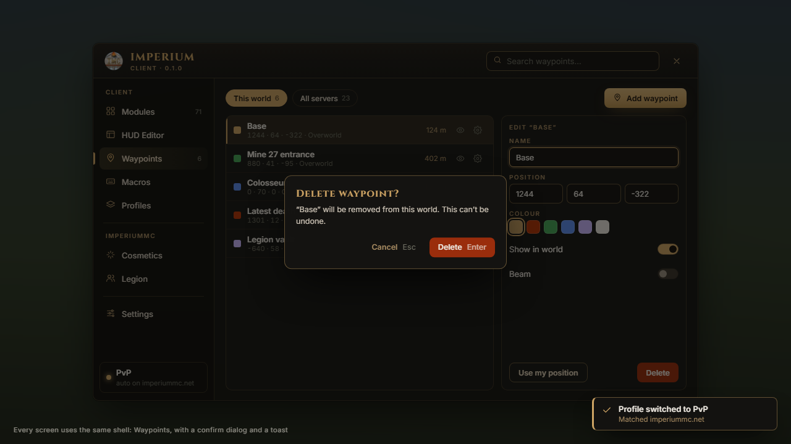
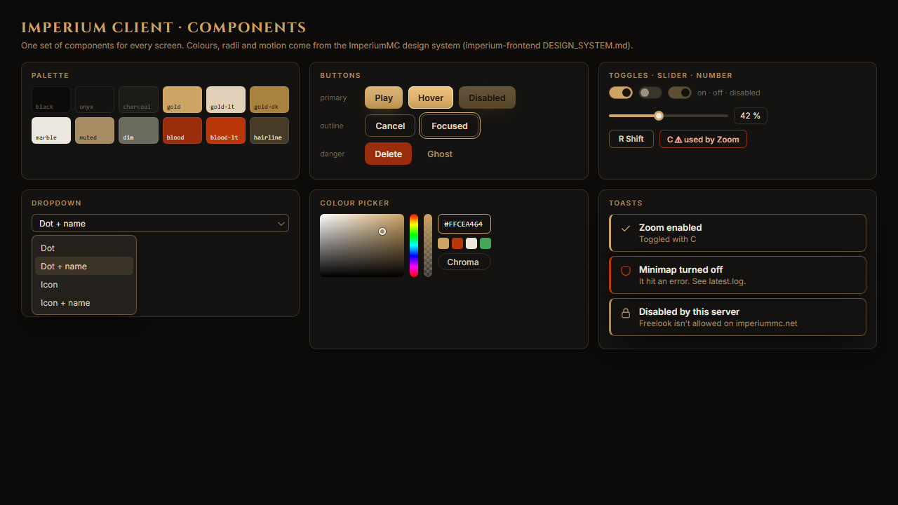

# Imperium Client UI

The client's screens should feel as clean as the best PvP client menus, and **every screen should look like
part of the same product**, in the ImperiumMC visual identity shared with the website and the launcher.
This document and the mockups in [`mockups/`](mockups/) are the target. The detailed behaviour spec is
issue #4; the quality bar is #3.

**Source of truth for colours, type and shape:** the website's design system,
`Imperium-MC/imperium-frontend` → `DESIGN_SYSTEM.md` and `src/app/globals.css`. If a value here disagrees
with that CSS, the CSS wins and this file should be fixed.

## Mockups

| | |
|---|---|
|  **01 Modules**: sidebar, search, category chips, module cards (enabled, hover, new, locked by server), tooltip, scroll fade |  **02 Module settings** inside the menu: back, reset, master toggle, live preview, grouped settings, search hit highlighted |
|  **03 HUD editor** over the live game: toolbar, snapping guides, selection handles, name tag, context menu with anchor picker |  **04 Title screen**: emblem plus Cinzel wordmark, Play ImperiumMC with live count, account switcher, news (example text) |
|  **05 Any other screen** (Waypoints here) in the same shell, with a confirm dialog and a toast |  **06 Components**: palette, buttons, toggles, slider, keybind conflict, dropdown, colour picker, toasts |

The HTML sources sit next to the PNGs (`imperium.css` holds the tokens). Change a token there, re-render and
compare. To render: serve the folder (`python -m http.server --directory docs/design/mockups`) and screenshot
at 1280×720, for example with Chrome headless
(`chrome --headless=new --window-size=1280,720 --screenshot=out.png http://localhost:8000/01-menu.html`).

## What makes it feel clean (rules, not taste)

1. **One shell.** Every client screen is the same panel: a 28 GUI px header (emblem, Cinzel "IMPERIUM",
   search, close), a ~100 GUI px sidebar and the content area. The mockups are drawn at 2× GUI scale, so
   halve their pixel sizes; where this disagrees with sizes in #4, the mockups win. No client screen uses vanilla's full-screen button stack or the
   AxolotlClient config look.
2. **Few colours, used the same way everywhere.** Warm near-black surfaces; gold only for accents, active
   states, focus and primary actions; blood red only for danger and server locks; marble for primary text.
   Borders are gold *hairlines* (alpha 18–42%), never solid gold.
3. **Generous, consistent spacing.** A 4 px grid (4/8/12/16/24). Rows are 20 GUI px (40 px at 2×). Cards
   are 59 GUI px tall. Nothing touches a panel edge.
4. **Hierarchy through type, not boxes.** Cinzel only for the wordmark and dialog titles; Inter for
   everything else; caps eyebrows (`10 px, 0.14em tracking, muted`) for section labels.
5. **Every control has hover, pressed, focused and disabled states**, and they look the same in every screen
   (06). Focus is a gold ring, hover is a 5% light overlay plus a stronger hairline.
6. **Motion is quiet.** 120–200 ms ease (`cubic-bezier(0.4, 0, 0.2, 1)`, the site's `--ease`), with no
   bounces. "Reduce motion" turns it all off.
7. **Icons, not emoji.** One 16 px line-icon set in the client's own style, the same shapes as the site's
   `Icon` component. The mockups use placeholder SVGs from `icons.js`; draw the final set as pixel-aligned
   textures (16×16 and 32×32).

## Tokens in the client

Put these in one Kotlin `object ImperiumTheme` (and the theme JSON for user themes, #4 §1). The values match
`globals.css`:

| Token | Value | Use |
|---|---|---|
| `black` | `#0C0B0A` | Backdrop tint (82% over the blurred world) |
| `onyx` | `#141311` | Panel (94%), inputs |
| `charcoal` | `#1D1B17` | Cards (85%), groups (60%) |
| `raised` | `#24211C` | Menus, tooltips, hovered cards |
| `gold` / `gold_light` / `gold_dark` | `#CEA464` / `#E0D1B8` / `#A8823F` | Accent, active text, pressed |
| `marble` | `#ECE7DF` | Primary text |
| `muted` / `dim` | `#A78B62` / `#6B6B5F` | Labels, descriptions / counts, placeholders |
| `blood` / `blood_light` | `#9A2D0C` / `#B93608` | Danger, server-locked |
| `hairline` / `hairline_strong` | gold @ 18% / 42% | Borders and separators |
| Radii | 6 (controls), 8 (buttons, nav), 10 (panels, cards) | |

## Fonts

- Bundle **Inter** (UI text) and **Cinzel** (wordmark and dialog titles) as TrueType font providers in the
  client's assets (`assets/imperiumclient/font/ui.json` and `display.json`, `"type": "ttf"`, oversample 2–4 so
  they stay crisp at every GUI scale). Both are SIL Open Font License 1.1: ship `OFL.txt` with them and
  credit them in the credits screen. The website already self-hosts the same fonts.
- Use them through `Component.literal(...).withStyle(style -> style.withFont(UI_FONT))`, cached per string
  (#3 §2).
- Setting **UI font: Imperium / Minecraft** (Settings → Menu) switches every client screen to the vanilla
  font for players who prefer it. Layout must hold with both, so test both in the gametests.
- HUD elements default to the Minecraft font (readable over the world) with a per-element option to use Inter.

## Making vanilla match too: a built-in "Imperium UI" resource pack

Some screens stay vanilla (Options, video settings, server list, inventories). To make them match, ship a
**built-in resource pack** (Fabric `ResourceManagerHelper.registerBuiltinResourcePack`, enabled by default,
switchable in Settings and in the vanilla pack list). It reskins the vanilla widget sprites in the same
palette:
- `gui/sprites/widget/button*.png` (normal, highlighted, disabled): charcoal with a gold hairline, 8 px radius
  look via 9-slice (`gui/sprites/widget/button.png.mcmeta` with `nine_slice`)
- `slider*`, `text_field*`, `scroller*`, `tab*`, `checkbox*`, `toast/*`, `tooltip/background` and `frame`,
  the menu background and list header/footer separators
- No changes to inventory/container textures (gameplay readability). The ImperiumMC server pack already
  styles those.

## Screen-by-screen

Every row ends up in the shell or in the built-in pack. "Shell" means a sidebar section or a sub-page of one
inside `ImperiumMenuScreen`. Build the shell and components first (#12 items 4–5), then move these.

| Current screen | Target |
|---|---|
| `imperium/menu/ImperiumMenuScreen` | Shell (01, 02), restyled to these tokens and the Inter font |
| AxolotlClient config screens (`ConfigStyles.createScreen`, rounded and vanilla styles) | Replaced by in-menu settings pages (02). Keep a hidden fallback for options with no widget yet |
| `modules/hud/HudEditScreen` | HUD editor (03) |
| `modules/hud/gui/keystrokes/*` (5 screens) | Keystrokes sub-pages in the shell (key list, positioning, special keys) |
| `config/screen/ProfilesScreen` | Shell → Profiles (#4 §8) |
| `modules/waypoints/WaypointsScreen` | Shell → Waypoints (05) |
| `modules/auth/AccountsScreen`, `AddOfflineScreen`, `DeviceCodeDisplayScreen` | Account switcher popover on the title screen plus a Settings → Accounts page; the device code shown in a dialog |
| `modules/auth/skin/SkinManagementScreen`, `LoadingScreen` | Shell → Cosmetics → Skin |
| `modules/screenshotUtils/*` (Gallery, Image, Crop, Download, LoadingImage) | Shell → Screenshots (gallery grid plus the editor from #8) |
| `config/screen/CreditsScreen` | Settings → About (credits for AxolotlClient, fonts, contributors) |
| `api/*` (Friends, chats, channels, news, privacy notice, add friend, username) | Social and Legion sections. These talk to AxolotlClient's servers and stay hidden until the Imperium backend replaces them (imperium-backend#2) |
| `api/multiplayer/FriendsMultiplayerScreen`, `mixin/api/JoinMulitplayerScreenMixin` | Hidden with the API (see above) |
| `modules/hypixel/*` config screens | Shell sub-pages under the Server category (or removed if Hypixel modules are dropped) |
| `mixin/TitleScreenMixin` | Title screen (04) |
| `mixin/GameMenuScreenMixin` | Vanilla pause screen plus the built-in pack, with an "Imperium Client" button (gold primary) and a "HUD Editor" button |
| Vanilla Options, Video, Controls, server list, chat screen | Built-in pack only (no layout changes) |
| Toasts, tooltips, context menus (`api/ContextMenu`) | The shared components (06) |

## Acceptance

- Gametests screenshot every shell section, the HUD editor, the title screen and the pause screen at GUI
  scale 2 and 3 and with both UI fonts, and compare them against these mockups in review.
- No client screen still uses `ConfigStyles`, vanilla `Button.builder` styling or AxolotlClient colours,
  except the documented fallback.
- Switching the theme, UI font or built-in pack updates open screens without a restart.
