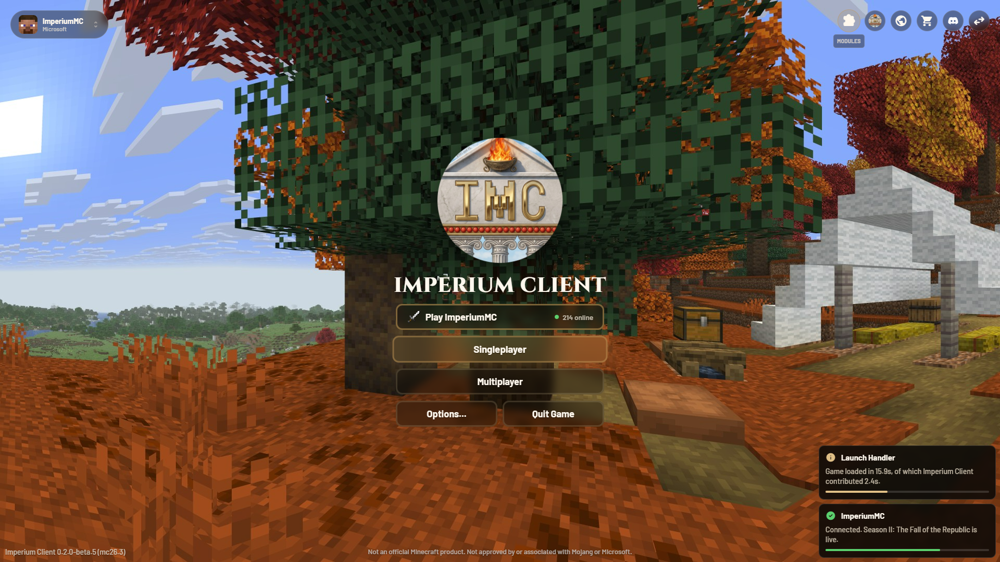

# Imperium Client UI

**Direction (owner decision, 2026-10-19): Alpine Client's menus, with ImperiumMC's emblem, name and colours.**
Copy Alpine's layout, proportions, motion and component set faithfully. What changes is the brand (emblem,
wordmark), the palette (bronze on warm dark) and the module icons (vanilla items). See
[`PRODUCT.md`](../../PRODUCT.md). Behaviour is specified in #4 and the quality bar is #3. This replaces the
earlier "carved stone" mockups.

## Mockups

Drawn at 1920×1080 in CSS pixels, the same units Alpine's own UI CSS uses.

| | |
|---|---|
|  **Title screen**: account switcher, top-right icon buttons, emblem and wordmark, Play ImperiumMC with the live player count, toasts, footer |  **Modules**: sidebar shell, category segments, search and enabled count, 3-column module cards in four states |
|  **Module settings** inside the shell: live preview, grouped setting rows, a search hit, profile note |  **HUD editor**: snap hint, centre guide, selection handles, context menu with anchor, help panel, bottom toolbar |

To render them, run `python extract-mc-assets.py <26.3.jar> <launcher assets dir>` (Mojang's textures stay
out of git), serve the folder with `python -m http.server --directory docs/design/mockups`, then screenshot
each page at 1920×1080 with headless Chrome.

## Measurements to copy (Alpine values, in GUI px at 1080p)

**Title screen**
- **Account switcher:** top-left, 20 px inset, radius 30, padding 8×15. Skin head 36 px (radius 8), name 14 bold, subtitle 11, `unfold_more` chevron.
- **Top-right buttons:** 40 px circles, 10 px gap, 1 px border, blur 8.
  - Hover scales to 1.1 and shows an uppercase 10 px label underneath.
  - Order: Modules, Imperium Client, imperiummc.net, Store, Discord, vanilla menu.
- **Centre column:** 12 px gap. Emblem 250 px, wordmark 38–40 px.
- **Buttons:** 400×50, radius 12, 3 px border, blur 8, text 18 bold.
  - Hover: control-hover fill, 40 px glow, scale 1.033. Press: 0.966.
  - Options and Quit share a row with a 10 px gap.
  - **Play ImperiumMC** sits on top with the live count from `/api/server/status`. Realms is hidden by default (a setting).
- **Toasts:** bottom-right, 340 px wide, padding 12, radius 10, blur 6. Icon 20, title 15 bold, body 14, progress track 4 px.
- **Footer:** 40 px. Version on the left, the Mojang disclaimer centred.

**Menu shell (every client screen)**
- **Full-screen dim:** `--color-surface`.
- **Sidebar:** 270 px wide, padding 30, `--color-layer`.
  - Header: emblem and two-line wordmark.
  - Nav items 48 px tall, radius 26, icon 24, label 16.5. The selected item has a pill indicator with a soft glow that slides between items (125 ms).
  - Footer pills 32 px.
- **Content header:** at x 314 / y 30. Title 22 bold, description 16.
- **Content:** from y 100, padding 8×44.
- **Top-right controls:** search 36 px pill; enabled count badge.
- **Category segments:** centred, 36 px.
- **Module cards:** 3 columns, gap 16, height 78, radius 22, 2 px border.
  - Icon well 46 px (radius 14) holding the **vanilla item icon at 32 px, nearest-neighbour**.
  - Name top-right, 16. Optional reason line bottom-left.
  - Actions bottom-right, 18–19 px: power, pin, settings.
  - States: default, hover, **enabled (bronze tint and border)**, **blocked by the server (red tint, `block` icon, reason line)**.
- **Setting rows:**
  - 44 px, radius 12. Hover brightens the row and accents the border. The reset icon sits at the row end.
  - Section headers: a 28×2 accent line plus a 14 px label.
  - Pairs of half-width rows.
  - Controls: checkbox 22 (radius 7), stepper with 32 px arrow buttons, slider (8 px track, 14 px knob shown on hover), colour swatch with hex, keybind chip 30 px.
  - A search hit gets an accent border plus a 3 px halo.

**HUD editor**
- Snap hint: pill at top centre.
- Snap guides in `--imp-accent-hot`.
- Selection: 2 px bronze outline with 10 px handles.
- Context menu: settings, reset, hide, 3×3 anchor picker.
- Bottom-left toolbar: Snapping, Undo, Modules, Done.
- Help: a 48 px circular button with a key/description panel.
- HUD text always uses the Minecraft font.

## Theme tokens

`imperium-ui.css` defines the **Imperium** theme using **Alpine's token names** (`--color-surface`,
`--color-layer`, `--color-panel-base`, `--color-primary`, `--color-accent`, `--color-text-accent`,
`--color-overlay-control`, `--color-overlay-border`, `--color-overlay-glow` …), so a theme is a single token
file. Ship Imperium as the default, and keep a vanilla-neutral dark theme as the alternative. In the client,
these become one Kotlin `ImperiumTheme` object loaded from `assets/imperiumclient/themes/*.json`.

| Token | Imperium value |
|---|---|
| `imp-accent` / `imp-accent-hot` | `#C39A58` / `#ECD6A6` |
| `color-surface` | `#0B0907` at 88 % |
| `color-layer` | `#17120C` at 42 % |
| `color-primary` / `-hover` | accent at 25 % / 35 % |
| `color-secondary` / `accent-soft` / `accent` | accent at 15 % / 30 % / 50 % |
| `color-text-accent` | `#E0BF86` |
| `color-text` / `-secondary` / `-tertiary` / `-disabled` | `#FFF8EE` / 78 % / 70 % / 75 % warm greys |
| `color-overlay-control` / `-hover` | `#17120C` at 42 % / accent at 25 % |
| `color-overlay-border` / `-hover` | `#ECD6A6` at 16 % / accent at 45 % |
| `color-success` / `color-error` | `#5BD06E` / `#E2603A` |

## Type and icons

- **Barlow** (OFL) for all UI text, weights 500/600/700. **Cinzel** (OFL) only for the IMPERIUM wordmark.
  Ship both as TTF font providers with `OFL.txt`. Settings has a "UI font: Imperium / Minecraft" option.
- **The Minecraft font** for HUD text and in-world numbers.
- UI icons are **Material Symbols Rounded** (Apache 2.0), filled, the same set Alpine uses. Bake the ~30
  glyphs used into SVG/PNG sprites under `assets/imperiumclient/textures/gui/icons/`. Never load fonts or
  icons from the network at runtime.
- Module icons are **vanilla item stacks** drawn with the item renderer (no copied textures). Every module
  needs one, and a test fails if any module has none.

## Rendering in the client

- **Rounded rectangles and soft glows:** draw with a small SDF rounded-rect shader (one `RenderPipeline`)
  so corners stay smooth at every GUI scale. Don't build them from `fill` calls.
- **Backdrop blur:** sample a downscaled copy of the frame (vanilla's menu-blur post pass already exists;
  reuse it). Respect the vanilla "Menu Background Blurriness" option, and fall back to plain translucency at 0.
- **Motion:** 200 ms ease-out for hover colour, 100 ms for scale, 125 ms for the nav indicator. All
  animation is disabled by a "Reduce motion" setting.
- **Sizes:** the measurements above are at 1080p with GUI scale 2. Scale everything from GUI pixels, never
  from screen pixels.

## Screens

| Current | Target |
|---|---|
| `mixin/TitleScreenMixin` | Title screen (04), with the vanilla rotating panorama for now and an ImperiumMC panorama later |
| `imperium/menu/ImperiumMenuScreen` | Shell plus module cards (01) |
| AxolotlClient config screens (`ConfigStyles.createScreen`) | Settings pages inside the shell (02); the old screens only as a hidden fallback |
| `modules/hud/HudEditScreen` | HUD editor (03) |
| Waypoints, Macros, Profiles, Cosmetics, Legion, Settings | Shell sections using the same rows, cards and buttons |
| Toasts, tooltips, confirms | Toast (04) and panel styles; confirms are a centred panel with ghost and accent buttons |
| Pause screen | Vanilla layout, restyled buttons, plus Imperium Client and Edit HUD buttons |
| Vanilla options, server list | Left vanilla; a later optional pack can restyle their widgets |

## Acceptance

- Gametests screenshot the title screen, every shell section, a settings page and the HUD editor at GUI
  scales 2 and 3. Post them next to these mockups in the PR.
- Side by side with Alpine at the same resolution, the layout and proportions match. Brand and colours
  differ.
- No client screen still uses vanilla grey buttons, `ConfigStyles` or the old CARVED/CLASSIC themes,
  except the documented fallback.
- Switching theme, UI font or "Reduce motion" updates open screens without a restart.
